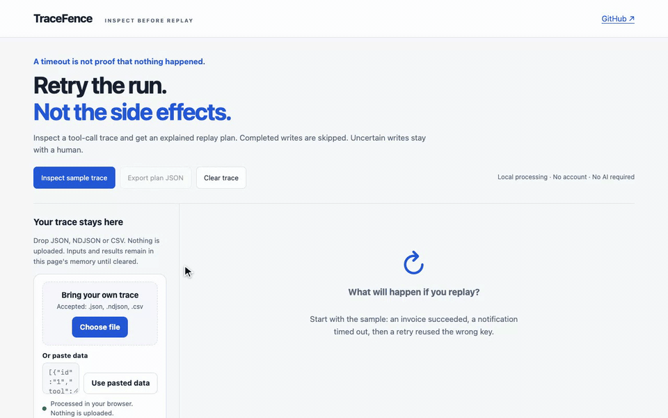

# TraceFence

TraceFence reviews agent tool-call logs before a retry. Open a trace to see completed writes, uncertain outcomes and conflicting idempotency keys. Processing runs in your browser.

[Try the live demo](https://tracefence.dallascrilley.com) · [Sample trace](public/sample.json) · [Concept & prior art](docs/CONCEPT.md)



A timeout does not tell you whether an invoice, ticket update or notification already happened. TraceFence reads the effects and outcomes recorded in a tool-call export:

- **Replay read.** the producer explicitly declared a read-only operation.
- **Skip completed.** the write is recorded as successful.
- **Review.** a write is uncertain, its effect is unknown, or the same tool/key carries different arguments.

The table shows a reason and related call IDs for each decision. An idempotency key is never treated as proof that a destination enforces it. No tool is executed.

## Try it

Open the demo and choose **Load sample trace**, or drop/paste your own JSON, NDJSON or CSV. Export the resulting plan as JSON. Processing is entirely in your browser; traces are held only in page memory, and **Clear** removes the input and result. No account, server upload, API key or AI model is required.

```sh
node bin/tracefence.js --json public/sample.json
cat your-trace.ndjson | node bin/tracefence.js --json -
```

The CLI uses the same pure rules and returns exit 2 for invalid input. Its schema-versioned JSON is suitable for agents and CI inspection; the output is advice and never authorizes execution.

## Input contract

```json
[{"id":"call-1","tool":"invoice.create","effect":"write","status":"timeout","arguments":{"invoice":"demo-17"},"idempotency_key":"invoice-17"}]
```

Required: unique string `id`, string `tool`, `effect` (`read`, `write`, `unknown`), `status` (`succeeded`, `failed`, `timeout`, `unknown`), and an `arguments` object. `idempotency_key` is optional. CSV encodes the arguments object as a JSON string in its cell. Browser inputs support 5 MiB and 10,000 calls; the CLI supports JSON/NDJSON at the same limits.

Tool+key scopes key conflicts; canonical JSON compares argument objects independently of key ordering. Arrays retain their order. Related calls share the same tool and arguments, which may represent intentional repeated work: relatedness alone is not evidence of a duplicate effect.

Effect labels and statuses come from the trace producer. A claimed read can still be dangerous if mislabeled. This tool does not query the destination, validate permissions, execute replays, prove exactly-once behavior, estimate money saved or infer causality. Reconcile uncertain external effects against their owning system before retrying. There is no automatic OpenTelemetry/LangSmith adapter yet; use the documented normalized format.

## Develop and verify

Node 20+. No application dependencies or build step.

```sh
npm test
npm run dev
# Browser proof/GIF reuse an installed Playwright + Chrome and ffmpeg:
NODE_PATH=/path/to/node_modules npm run demo
NODE_PATH=/path/to/node_modules npm run verify
```

Depot runs `script/cibuild` on each source push. Unit/CLI tests cover the actual decision rules; local browser verification additionally exercises sample input, your own data with zero processing requests, invalid input, safe text rendering, JSON export, reset and a mobile viewport. `docs/PRACTICE.md` provides an explanation-and-change guide.

## Status

Initial public release: browser inspector plus dependency-free CLI. The included trace is synthetic and clearly labeled. The rules operate on supplied trace data. MIT licensed. Built with [byo-kit](https://github.com/dallascrilley/byo-kit).

<!-- byo-kit:case-study:start -->

## Case study

[Treat timed-out agent writes as unknown outcomes](https://dallascrilley.com/writing/tracefence-unknown-outcomes/)

<!-- byo-kit:case-study:end -->
